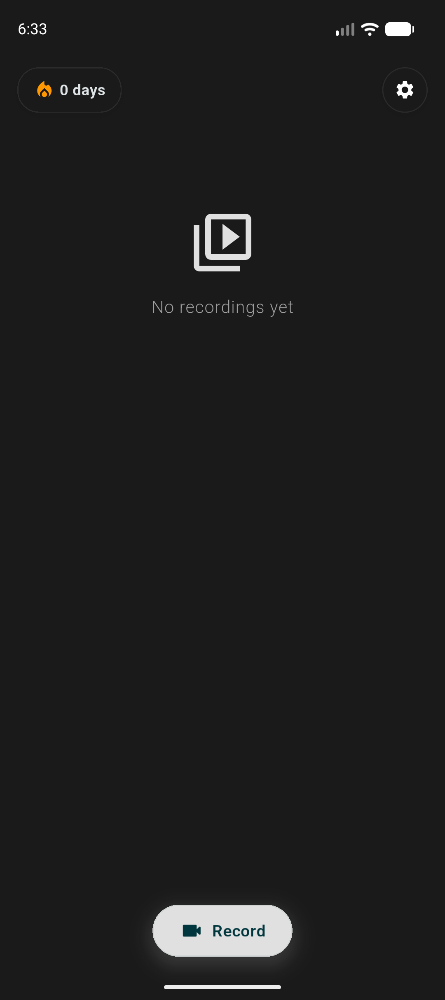
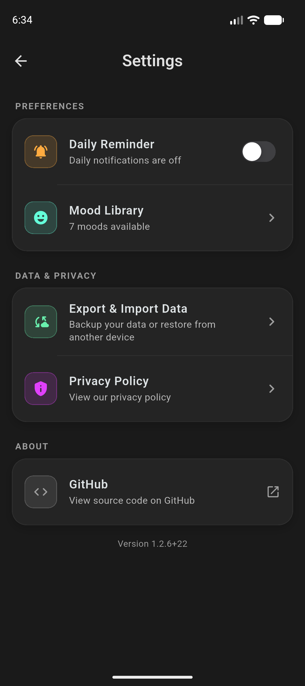

<div align="center">
  

# Video Diary

**Keep the moments you want to remember.**

Record short video entries, add a mood, and revisit your personal timeline.

[](https://github.com/kargalar/video-diary/releases/latest) [](https://github.com/kargalar/video-diary/releases/latest) [](LICENSE)

[Download for Android ↓](https://github.com/kargalar/video-diary/releases/latest) · [Build from source](#build-from-source) · [Report an issue](https://github.com/kargalar/video-diary/issues)

</div>



## Keep a personal video timeline

Record a moment, give it a mood, and find it again by date. Video Diary stores journal entries and their media on your device, with backup and restore options when you choose to move your archive.



## Features

- Record and play back video diary entries.
- Organize recordings by day and add mood labels.
- Search, filter, rename, and manage saved entries.
- Export and restore a backup of your diary.
- Set a daily recording reminder.
- Keep recorded media in the app’s local storage.

## Install

Download the latest **Video Diary APK** from [GitHub Releases](https://github.com/kargalar/video-diary/releases/latest), install it on Android, and grant camera and microphone access when you choose to record.

## Build from source

Install [Flutter](https://docs.flutter.dev/get-started/install) and the Android SDK, then run:

```sh
flutter pub get
flutter analyze
flutter test
flutter build apk --release
```

The release build uses a local Android signing key configured through the ignored `android/key.properties` file. Never commit signing credentials or keystore files.

## License

Video Diary is licensed under the GNU General Public License v3.0. See [LICENSE](LICENSE).
